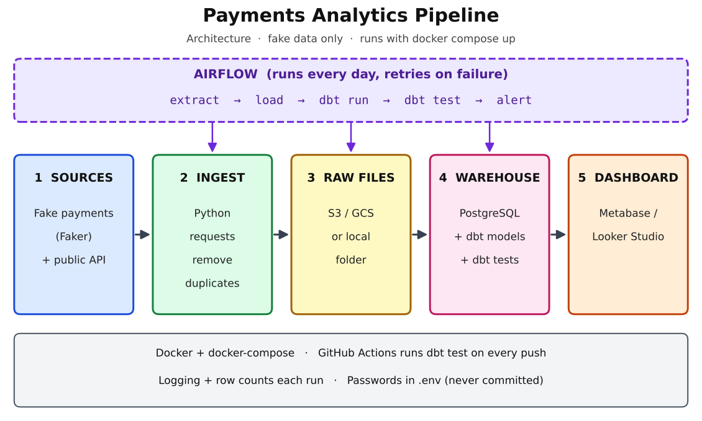
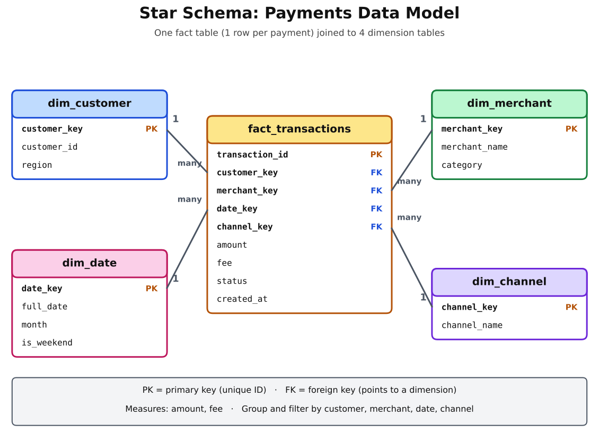

# Payments Analytics Pipeline

A daily data pipeline that ingests mobile-money payment transactions, cleans and models them,
tests their quality, and serves business metrics on a dashboard.

> ⚠️ All data in this project is **fake**, generated by `ingestion/generate_fake_data.py`.
> No real customer or company data is used.

## Architecture


## Data model


## Tech stack
| Layer | Tool | Status |
|---|---|---|
| Ingestion | Python | ✅ v1 |
| Warehouse | PostgreSQL (Docker) | ✅ v2 |
| Transformations & tests | dbt | ✅ v4 |
| Orchestration | Airflow | ⬜ v5 |
| Dashboard | Metabase | ⬜ v6 |

## Quick start (Windows PowerShell)
```powershell
# 1. Start Postgres
copy .env.example .env
docker compose up -d

# 2. Python environment
python -m venv .venv
.venv\Scripts\Activate.ps1
pip install -r requirements.txt

# 3. Generate fake data, then load it (safe to re-run)
python ingestion/generate_fake_data.py --days 7
python ingestion/load_to_postgres.py
```

## Business questions answered
- What is the daily payment success rate per channel?
- Which merchants generate the most fee revenue?
- How many duplicate or failed transactions were caught?
- How much money is stuck in pending transactions?

## Design decisions
- **Idempotent loads:** `INSERT ... ON CONFLICT DO NOTHING` on `transaction_id`, so re-running a day never creates duplicates.
- **Messy data on purpose:** the generator adds ~2% duplicates and some missing amounts, to prove the cleaning steps work.
- *(Add your own as you build: why ELT, why incremental models, etc.)*

## Roadmap
- [x] v1 Fake data + CSV
- [x] v2 Postgres load with upserts
- [ ] v3 Docker for the whole pipeline + raw files in S3/GCS
- [x ] v4 dbt staging → marts + tests
- [ ] v5 Airflow daily DAG
- [ ] v6 Dashboard + alerts

## What I would improve next
*(Fill in at the end.)*
